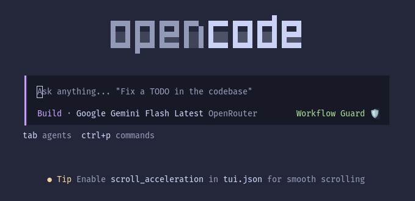

# OpenCode Workflow Guard

[](https://www.npmjs.com/package/opencode-workflow-guard)
[](https://opensource.org/licenses/MIT)
[](test/test.mts)

Deterministic policy and enforcement layer for OpenCode. Workflow Guard enforces engineering discipline through **hard plugin hooks**, not prompt instructions that an LLM can ignore. The plugin also exposes a proactive workflow-tool surface for planning, review, worktree isolation, technical debt, and policy simulation.

Workflow Guard is deliberately **not an agent harness**. It can constrain actions, record and explain decisions, and supply bounded context. It does not plan, prioritize, delegate, or autonomously sequence the agent's work. Bounded continuation may resume an existing session with unfinished owned todos. It never chooses the next task or creates new work.

---

## Quick Start

### 1. Installation

Install the current published version globally:

```bash
VERSION=$(npm view opencode-workflow-guard version)
opencode plugin add "opencode-workflow-guard@$VERSION"   # OpenCode 2.x
opencode plugin "opencode-workflow-guard@$VERSION" --global --force   # OpenCode 1.x
```

*Requires OpenCode >= 1.18.* OpenCode detects the package's server and TUI targets and updates both global configs. Run the same command after a release to upgrade. The explicit version gives OpenCode a fresh package-cache key. Restart OpenCode after installation. See [docs/installation.md](docs/installation.md) for details and links to the OpenCode plugin documentation.

The plugin supports both generations from one package. **OpenCode 1.x** loads the `server()` entrypoint, and **OpenCode 2.x** loads the `setup()` entrypoint (`@opencode/plugin`). Policies, tools, and configuration behave the same on both. V2 load tests run against a real OpenCode 2 binary in `npm run test:install`.

For the optional TUI badge, configure `"opencode-workflow-guard"` in `tui.json`. OpenCode resolves the package's exported `./tui` entrypoint automatically for TUI plugins. The companion keeps a static `Workflow Guard` shield in the prompt bar. Warning toasts provide block details without changing agent behavior. Do not place the TUI module under the server `plugins/` directory.



### 2. Verification

```bash
npm run typecheck    # Strict TypeScript check (0 errors)
npm test             # Run 1100+ unit and adversarial tests
npm run test:all     # Typecheck + unit + install/load checks
WORKFLOW_GUARD_LIVE_E2E=1 npm run test:install # Also run policy probes with OpenCode's most recently selected model
```

---

## Core Guardrails Overview

The plugin enforces **26 deterministic policy rules** across four main pillars:

* **Branch & History Protection:** Enforces feature-branch workflows and blocks edits and commits on `main`/`master`. Direct and forced pushes to protected branches are hard-blocked. The guard checks mergeability before PR creation, requires secondary review approval bound to the reviewed worktree content, and requires a PR changelog or changeset.
* **Task & Verification Discipline:** Gates file mutations on active `todowrite` tasks, which subagents inherit. A task can be marked completed only after its own recorded work. Review and investigation tasks use an audited `[read-only]` marker instead. The guard also blocks concurrent direct edits to the same canonical file across sessions. It requires a same-session fresh read before `edit`/`write` can replace an existing file. Silent task deletion is blocked, and task completion requires fresh test verification evidence. Completion claims and sweeping repository claims are journaled against their evidence. Repeated failures force a live-documentation lookup instead of a guess from training data.
* **Secrets & Workspace Confinement:** Confines edit tools and recognized shell/git mutations to the workspace root, including symlink and `../` escape checks. Agent subshells have sensitive environment variables scrubbed, and `.env` reads return a safe schema mask. Arbitrary executables are not OS-sandboxed. Use containers or filesystem isolation when hard confinement is required.
* **Destructive CLI & Environment Safety:** Intercepts destructive cloud, database, and infrastructure commands. Stops script laundering and interpreter evasion, blocks TTY hangs such as `vim`, `nano`, and `sudo`, and guards against dangerous package manager flags.

For complete policy specifications and override rules, see [docs/policies.md](docs/policies.md).

---

## Proactive Workflow Tools

Enforcement is only half the surface. The plugin also registers first-class agent tools under the same names on OpenCode 1.x and 2.x, so disciplined workflow is the path of least resistance:

* **Task Planning:** `guard_next_tasks` surfaces durable repository planning context at session start or during planning. It reads `TODO.md`, `ROADMAP.md`, `PLAN.md`, `TASKS.md`, `BACKLOG.md`, their `docs/` counterparts, and plans under `docs/plans/`. `guard_status` reports active guardrails, branch protection, mutation counts, outstanding verification and review gates, a read-only git-hygiene snapshot, and the loaded `pluginVersion`.
* **Review & Verification:** before PR creation, a secondary reviewer subagent evaluates the diff against `guard_review_rubric`. The rubric covers five axes: test integrity, task completeness, cleanliness, security, and platform. The reviewer records its verdict with `record_review`, and approvals bind to the reviewed worktree content.
* **Worktree Isolation:** `guard_worktree_create` and `guard_worktree_cleanup` give parallel subagents isolated linked worktrees, so concurrent mutations never collide.
* **Technical Debt:** `guard_review_followups` lists open P2/P3 durable review follow-ups. `guard_review_followup_resolve` closes one after the underlying issue is fixed and verified.
* **Policy Simulation:** `guard_why` returns the structured policy decision for a tool call or command without performing it. `guard_audit` shows recent audited policy entries.
* **Project Memory** (on by default): `project_memory_search`, `project_memory_record`, `project_memory_export`, and `project_memory_import` maintain durable facts, decisions, constraints, and lessons. Secret content is rejected. Export promotes records to the repo-local `.opencode/memory/project-memory.jsonl`.
* **Socratic Learning** (off by default): `learning_checkpoint`, `learning_profile`, and `learning_record` maintain a global evidence-based learner profile with a per-session intervention budget.

The context modules are project memory, Socratic learning, and recovery checkpoints (`guard_recovery_restore`). Each is independently gated, so any of them can be disabled without weakening policy enforcement. See [docs/installation.md](docs/installation.md). Full tool specifications live in [docs/policies.md](docs/policies.md#custom-tools).

---

## Documentation Index

| Guide | Description |
|---|---|
| [**Policy Reference**](docs/policies.md) | Specification of all 26 enforced policies, invariants, and the proactive tool surface (`guard_*`, `project_memory_*`, `learning_*`) |
| [**Installation & Configuration**](docs/installation.md) | Setup options, global and local install, worktree isolation, and project configuration |
| [**Static Policy Posture**](docs/policy-posture.md) | How the guard emits host-level policies for invariants a repository cannot lift. Covers both host envelopes (`experimental.policies` on 2.0.x, top-level `policies` on 2.1.x), precedence, and residual risk |
| [**Managed Deployment**](docs/managed-deployment.md) | Administrator-managed OpenCode policy, platform locations, and startup diagnostics |
| [**Troubleshooting**](docs/troubleshooting.md) | Diagnosing policy blocks, common false positives, and the live-system override |
| [**Testing Architecture**](docs/testing.md) | Test harness design, adversarial regression matrix, and CI verification |
| [**Contributing Guide**](CONTRIBUTING.md) | Development workflow, coding conventions, test requirements, and changeset PR rules |
| [**Security Policy**](SECURITY.md) | Vulnerability disclosure policy and threat model |

---

## License

[MIT](LICENSE)
